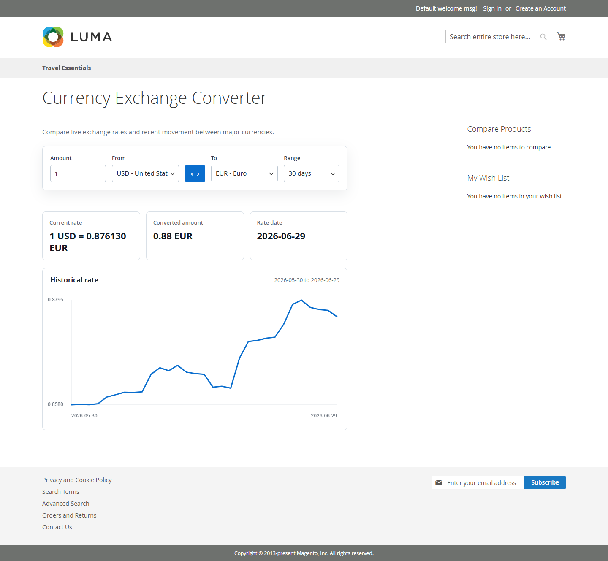
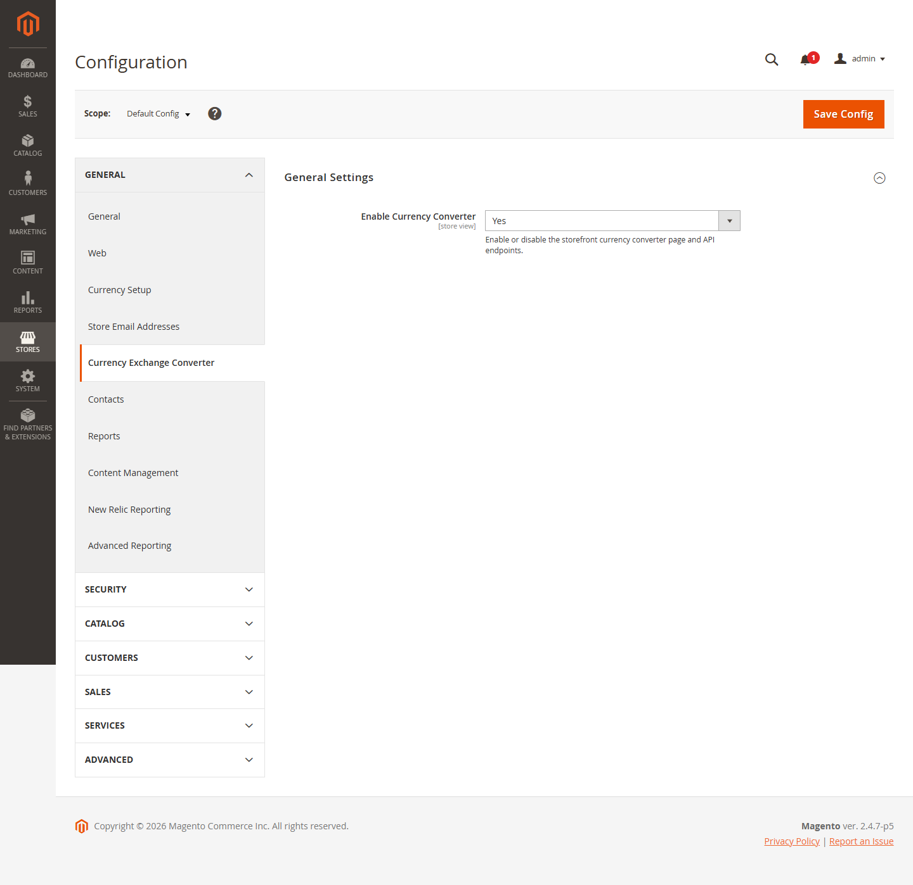

# Currency Exchange Converter for Magento 2

Custom Magento 2 module that adds a storefront currency exchange converter using the Frankfurter API.

## Features

- Storefront currency converter page
- Amount input
- From and To currency selectors
- Currency list loaded from Frankfurter
- Current exchange-rate lookup
- Historical exchange-rate chart
- Swap control for From/To currencies
- Admin enable/disable setting
- No custom database tables

## Screenshots

### Storefront



### Admin Configuration



## Requirements

- Magento 2.4.x
- PHP 8.1, 8.2, or 8.3
- Outbound HTTPS access to `https://api.frankfurter.dev`

Tested locally with:

- Magento 2.4.7-p5
- PHP 8.2

## Installation

Copy this repository content into your Magento project at:

```text
app/code/Dilip/CurrencyConverter
```

Example final path:

```text
app/code/Dilip/CurrencyConverter/registration.php
app/code/Dilip/CurrencyConverter/etc/module.xml
```

Then run these commands from Magento root:

```bash
php bin/magento module:enable Dilip_CurrencyConverter
php bin/magento setup:upgrade
php bin/magento cache:flush
```

For production mode, also run:

```bash
php bin/magento setup:di:compile
php bin/magento setup:static-content:deploy -f
php bin/magento cache:flush
```

## Storefront URL

After installation, open:

```text
/currency_converter
```

Example:

```text
https://example.com/currency_converter
```

## Admin Configuration

Admin can enable or disable the converter from:

```text
Stores > Configuration > General > Currency Exchange Converter
```

Setting:

```text
Enable Currency Converter = Yes / No
```

Default value is:

```text
Yes
```

When disabled:

- Storefront page returns Magento no-route page
- JSON endpoints return `403`

## How It Works

1. Buyer opens `/currency_converter`.
2. Magento renders the converter page.
3. JavaScript loads supported currencies from:

```text
/currency_converter/index/currencies
```

4. Magento calls Frankfurter:

```text
https://api.frankfurter.dev/v2/currencies
```

5. Buyer selects From and To currency.
6. JavaScript requests current rate from:

```text
/currency_converter/index/rate
```

7. Magento calls Frankfurter:

```text
https://api.frankfurter.dev/v2/rate/{BASE}/{QUOTE}
```

8. JavaScript requests historical rates from:

```text
/currency_converter/index/history
```

9. Magento calls Frankfurter:

```text
https://api.frankfurter.dev/v2/rates
```

10. The frontend updates the converted amount and chart.

## Security Notes

- No custom SQL queries are used.
- No custom database tables are created.
- Currency inputs are validated as three-letter currency codes.
- History range is limited between 7 and 365 days.
- Frontend template output uses Magento escaping.
- JavaScript uses text insertion for messages, not raw HTML.
- Frankfurter API base URL is fixed in dependency injection config.
- External API request timeout is set to 10 seconds.

## Main Files

```text
registration.php
etc/module.xml
etc/frontend/routes.xml
etc/adminhtml/system.xml
etc/config.xml
etc/acl.xml
Controller/Index/Index.php
Controller/Index/Currencies.php
Controller/Index/Rate.php
Controller/Index/History.php
Model/FrankfurterClient.php
Model/Config.php
ViewModel/Converter.php
view/frontend/templates/converter.phtml
view/frontend/web/js/converter.js
view/frontend/web/css/converter.css
```

## Uninstall

From Magento root:

```bash
php bin/magento module:disable Dilip_CurrencyConverter
php bin/magento setup:upgrade
php bin/magento cache:flush
```

Then remove:

```text
app/code/Dilip/CurrencyConverter
```
